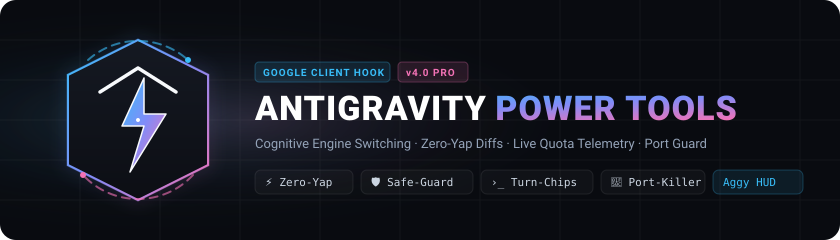
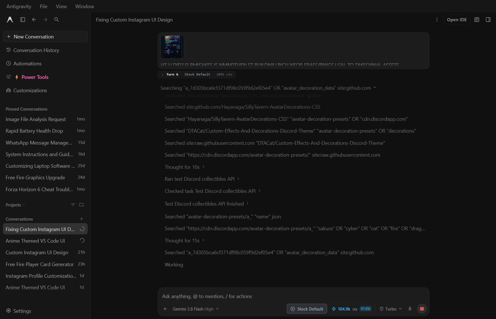
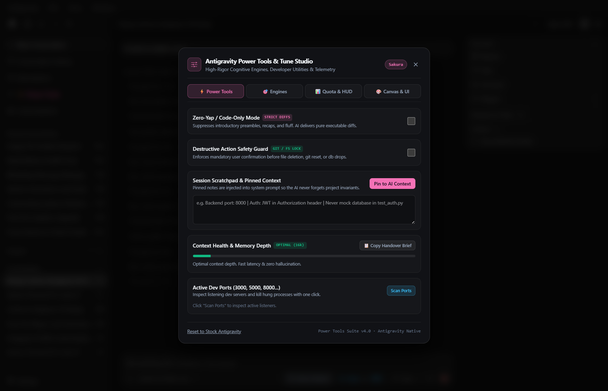
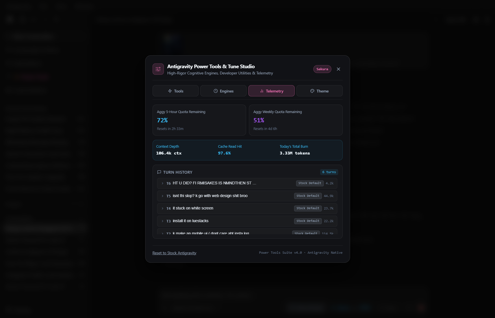
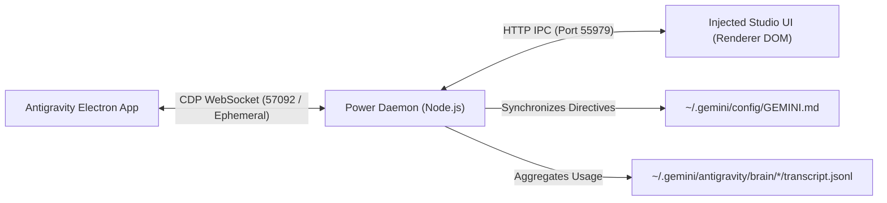

<p align="center">
  
</p>

<p align="center">
  <strong>The essential developer utility suite for the Google Antigravity desktop client.</strong><br>
  Runtime CDP injection, per-chat cognitive engine switching, zero-yap mode, destructive action guards, and live LLM telemetry.
</p>

<p align="center">
  <a href="LICENSE"></a>
  
  
  
  
</p>

---

## Overview

**Antigravity Power Tools** hooks directly into Google Antigravity’s local Electron runtime via Chrome DevTools Protocol (CDP). It injects native developer utilities directly into the sidebar and chat interface without modifying the binary on disk:

* **Zero-Yap / Code-Only Mode**: Injects strict prompt directives suppressing conversational preambles and chat filler. Delivers pure executable code and unified diffs.
* **Destructive Action Safety Guard**: Mandatory confirmation boundary before the AI can execute file deletions, database drops, or destructive git operations (`git reset --hard`, `git clean`).
* **Session Scratchpad**: Pinned project notes and architectural invariants injected into the session prompt across chat turns.
* **Cognitive Engine Switching**: Switch operational personas per conversation (*TDD Test Engineer*, *Security Auditor*, *Elite Bug Fixer*, *Terminal Sovereign*, *Claude Thinking Engine*).
* **Live Aggy Quota & Token Telemetry**: Real-time tracking of 5-hour and weekly quota resets, active prompt cache hit rates, and aggregate daily token burn.
* **Dev Ports Inspector**: Local port auditor (3000, 5000, 8000, 8080) with 1-click termination for hung server processes.
* **Minimalist SVG Turn Shower**: Understated, non-intrusive vector breadcrumbs (`› Turn 8 · Stock Default · 125k ctx`) attached directly below prompts.

---

## Quick Installation

Run the 1-click installer in PowerShell (or double-click `install.bat`):

```powershell
git clone https://github.com/prashanth-karanam/antigravity-power-tools.git
cd antigravity-power-tools
powershell -ExecutionPolicy Bypass -File install.ps1
```

### What the installer does
1. Synchronizes runtime scripts and cognitive doctrines to `~/.gemini/config/power-tools`.
2. Registers a silent Windows Startup hook (`AntigravityPowerTools.vbs`) so the background daemon runs invisibly on login with zero console flashing.
3. Automatically attaches to Antigravity whenever the application opens.

---

## Visual Showcase

### 1. Minimalist SVG Turn Breadcrumb
Quiet, vector-rendered turn badges anchored directly beneath user prompts with zero emoji clutter:

<p align="center">
  
</p>

### 2. Developer Power Tools Suite
Zero-Yap mode, destructive action guards, pinned context scratchpad, and active dev port killer:

<p align="center">
  
</p>

### 3. Live Telemetry & Turn History
Accurate Aggy quota countdowns, prompt cache hit rate, and scrollable session turn history:

<p align="center">
  
</p>

---

## Core Capabilities

### ⚡ Zero-Yap / Code-Only Mode
Toggling Zero-Yap injects high-priority directives into the active prompt pipeline:
> *Output ONLY code, command execution, or unified diffs. Omit all introductory pleasantries, conversational filler, and concluding recaps.*

### 🛡️ Destructive Action Safety Guard
Prevents agentic accidents by locking destructive commands behind explicit user approval:
> *MANDATORY: Before executing any command that deletes files, wipes git history, or drops databases, you MUST ask the user for confirmation.*

### 🎯 Cognitive Engine Doctrines
Seamlessly toggle operational specializations per chat. Personas are automatically synchronized to `GEMINI.md`:
* **TDD Test Engineer**: Enforces test-first design, mock hermeticity, edge case boundary assertion, and regression-free diffs.
* **Security & Vulnerability Auditor**: OWASP Top 10 defenses, token/secret leakage audits, and sanitization boundaries.
* **Elite Bug Fixer**: Deductive root-cause tracing, stack trace dissection, and antifragile resilience.
* **Shadow Monarch Terminal**: Universal terminal execution, diagnostic self-healing, and polyglot command mastery.
* **Claude Thinking Engine**: Deep-reasoning, multi-perspective chain-of-thought analysis.

### 🔌 Dev Ports Inspector
Inspects active listeners on development ports (`3000`, `3001`, `4200`, `5000`, `5173`, `8000`, `8080`, `9000`) via PowerShell TCP connection tables and kills orphaned processes with a single click.

---

## Architecture



* **Zero Binary Modification**: Antigravity's core packages remain untouched. Everything is injected dynamically at runtime via Chrome DevTools Protocol.
* **Zero External Dependencies**: Pure native Node.js (`http`, `fs`, `child_process`) and Windows PowerShell.

---

## Uninstallation

To cleanly remove the startup hook and restore stock settings:

```powershell
powershell -ExecutionPolicy Bypass -File uninstall.ps1
```
*(Or double-click `uninstall.bat`)*

---

## License

[MIT License](LICENSE) © 2026 [Prashanth Karanam](https://github.com/prashanth-karanam)
